<picture>
  <source media="(prefers-color-scheme: dark)" srcset="assets/hero-dark.svg">
  <source media="(prefers-color-scheme: light)" srcset="assets/hero-light.svg">
  
</picture>

 

### 👋 About me

I lead data engineering at **[Cienty](https://cienty.com.br)**, a B2B purchasing platform for pharmacies in Brazil.

I built the company's data platform from day one: a **Medallion** architecture on BigQuery,
everything as code, real-time ingestion, and an AI agent layer that lets the whole team
work with data safely.

### 🛠 What I build

- 🏛 **Data platform**: Bronze → Silver → Gold, with every table and every load versioned in Terraform
- ⚡ **Ingestion**: real-time CDC from transactional databases, plus APIs and scrapers
- 👁 **Observability**: agents that watch freshness, volume and job health, and alert before anyone notices
- 🤖 **AI for data**: Claude skills and agents that query data, create tables and open PRs following team standards
- 🔐 **Governance and cost**: group-based access, a living data dictionary and close cost tracking

### 🧰 Stack

  

  

<picture>
  <source media="(prefers-color-scheme: dark)" srcset="https://raw.githubusercontent.com/wescamargo/wescamargo/output/github-snake-dark.svg">
  <source media="(prefers-color-scheme: light)" srcset="https://raw.githubusercontent.com/wescamargo/wescamargo/output/github-snake.svg">
  
</picture>

❯ raw data in, decisions out

